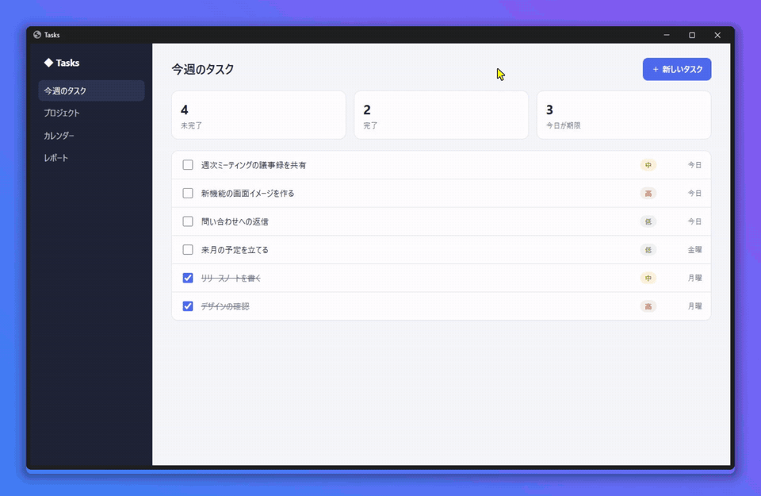

<div align="center">


# Snappi

**操作したところに自動で寄る、Windows 向けの画面録画アプリ**

録画して、止めて、書き出すだけ。編集しなくても、そのまま人に見せられる動画ができます。

[](https://github.com/hexylab/snappi/releases/latest)
[](LICENSE)
[](https://github.com/hexylab/snappi/releases/latest)

[**ダウンロード**](https://github.com/hexylab/snappi/releases/latest) ·
[不具合の報告](https://github.com/hexylab/snappi/issues)



<sub>↑ Snappi で録画して、そのまま書き出した動画です（自動ズームのみ・手での編集は前後のカットだけ）</sub>

</div>

---

## できること

画面を普通に録画するだけで、次のような見やすい動画になります。操作の説明、手順書、バグの報告、デモに。

- **操作したところに自動で寄る** — 文字を打てば入力欄、メニューを開けばメニュー、ダイアログならダイアログ全体へ。
  マウスの位置ではなく、操作で画面が変わった場所を見て寄るので、映したいものが外れにくくなっています
- **カメラは落ち着いて動く** — 同じ場所での一連の操作ではカメラを止め、場面が変わるときだけ先回りして動きます
- **見た目を自動で整える** — 背景・影・角丸、なめらかなカーソル、クリックの表示、押したキーの表示
- **前後の余分な時間を自動でカット** — 録画開始や停止の操作は動画に残りません
- **録画中は小さなバーだけ** — Snappi の画面は録画に映りません
- **音声** — PC の音とマイクを録音できます（両方なら 1 つにまとめます）
- **書き出し** — MP4 / GIF / WebM、画質は 3 段階

自動の結果を直したいときは、プレビューの「細かく編集」をオンにすると、ズームの追加・削除・長さの調整、ズームの強さの変更、前後のカットができます。

## インストール

[Releases](https://github.com/hexylab/snappi/releases/latest) からインストーラーをダウンロードして実行してください。

| ファイル | 説明 |
|---|---|
| `Snappi_x.x.x_x64-setup.exe` | インストーラー（おすすめ） |
| `Snappi_x.x.x_x64_en-US.msi` | MSI（社内での一括配布など向け） |

動作環境: Windows 10 / 11（64bit）

> [!NOTE]
> インストーラーにはコード署名をしていないため、初回は「Windows によって PC が保護されました」と表示されることがあります。
> 「詳細情報」→「実行」で起動できます。

## 使い方

1. 録画する範囲（画面全体／ウィンドウ）と音声を選んで「録画を開始」
2. いつもどおり操作する（`Ctrl+Shift+R` でも開始・停止できます）
3. 録画バーの「停止」を押すと、自動で編集された動画のプレビューが開きます
4. 「動画を書き出す」

## プライバシー

- 録画はすべてこの PC の中（`ビデオ\Snappi`）に保存され、外部には送信しません
- 押したキーの内容（文字）は、設定でオンにしない限り記録しません（キーの種類だけを記録します）

## 開発者向け

### 必要なもの

- [Node.js](https://nodejs.org/) 18 以上
- [Rust](https://rustup.rs/)（stable）と [Tauri v2 の前提条件](https://v2.tauri.app/start/prerequisites/)
- FFmpeg: [gyan.dev](https://www.gyan.dev/ffmpeg/builds/) の 8.0.1 full ビルドの `bin\ffmpeg.exe` を `src-tauri/ffmpeg/` に置く
  （詳しくは [src-tauri/ffmpeg/README.txt](src-tauri/ffmpeg/README.txt)）

### 開発

```bash
npm install
npm run tauri dev
```

### 配布用のビルド

```bash
npm run release
```

`src-tauri/target/release/bundle/` にインストーラーができます。
`npm run release` は、ビルドした PC のパス（ユーザー名を含む）が exe に残らないようにしてビルドし、残っていないことを確かめます。
配布するものは `npx tauri build` ではなく、必ずこちらで作ってください。

構成や設計は [CLAUDE.md](CLAUDE.md)、カメラの仕様は [docs/camera-spec.md](docs/camera-spec.md)、見た目のルールは [DESIGN.md](DESIGN.md) にあります。

## ライセンス

Snappi は [MIT License](LICENSE) です。

インストーラーには、動画の書き出しに使う [FFmpeg](https://ffmpeg.org/)（GPLv3、gyan.dev のビルド）が含まれます。
FFmpeg は Snappi とは別のプログラムとして同梱しており、ライセンス本文・ソースの入手先は
インストール先の `ffmpeg` フォルダと [src-tauri/ffmpeg/README.txt](src-tauri/ffmpeg/README.txt) にあります。
FFmpeg のソースは各リリースにも添付しています。
